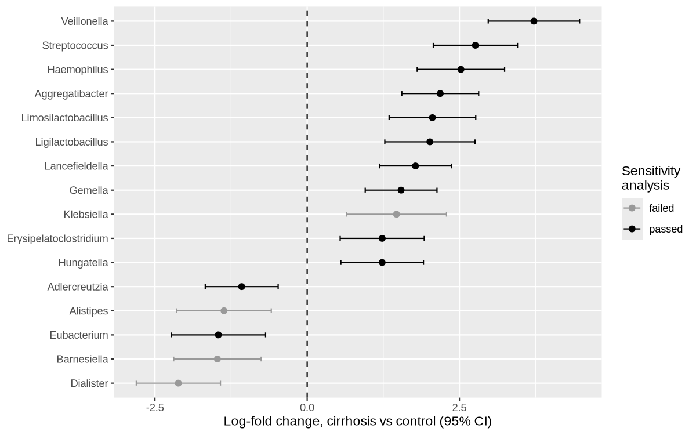
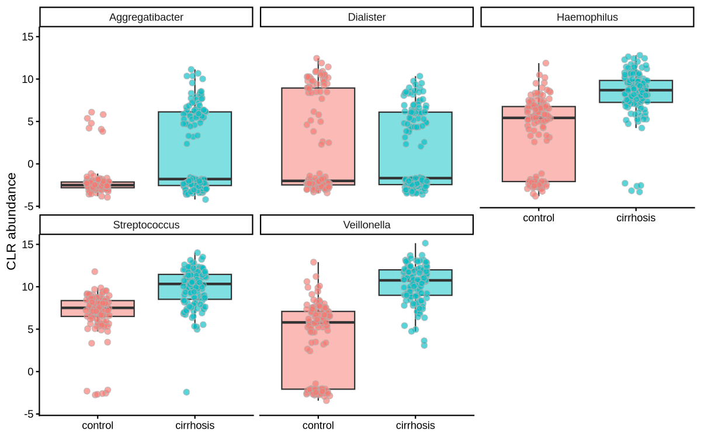
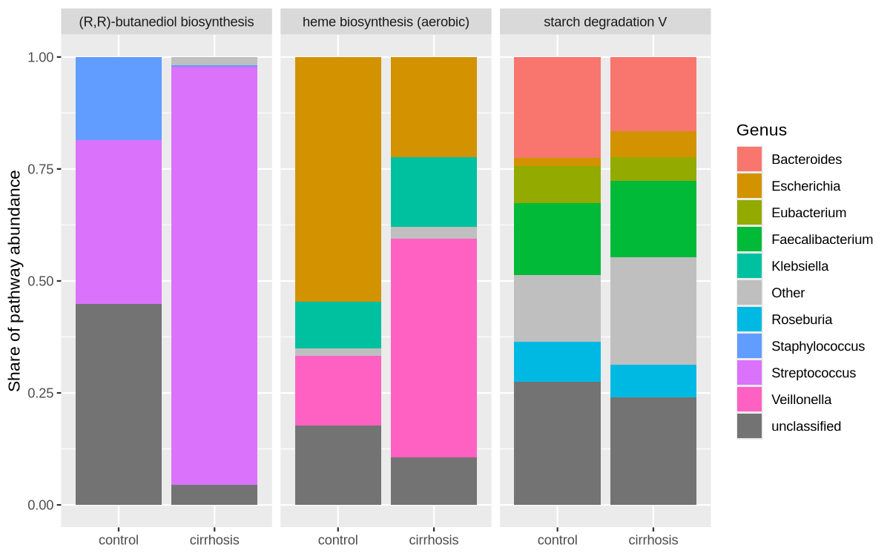
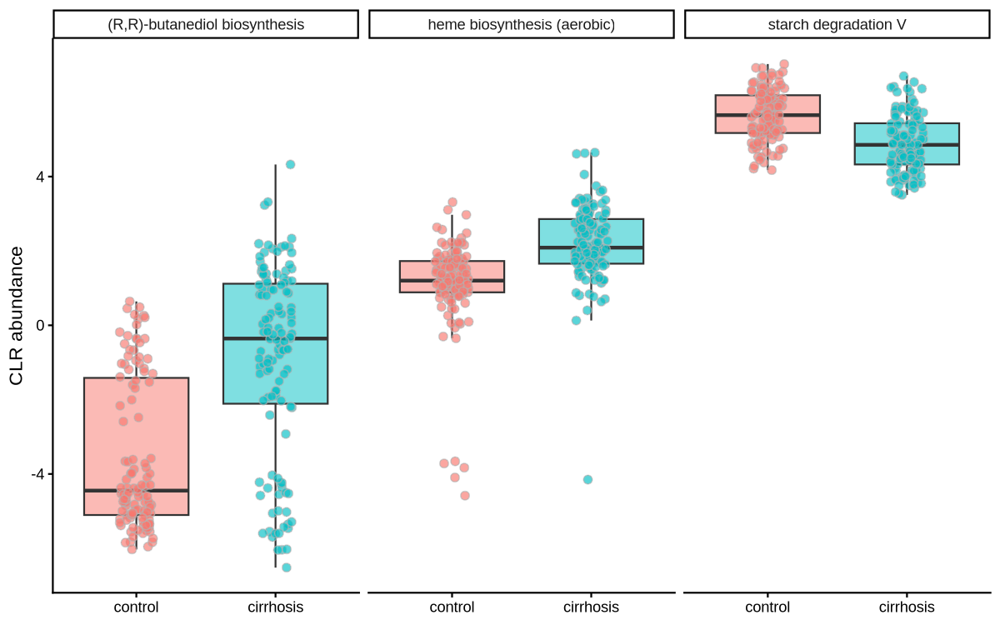

:::::::::::::::::::::::::::::::::::::: questions

- Which taxa differ in abundance between groups of samples?
- Why can we not simply run a t-test on relative abundances?
- How do we read and check the results of ANCOM-BC2?
- What might the differentially abundant taxa be doing?

::::::::::::::::::::::::::::::::::::::::::::::::

::::::::::::::::::::::::::::::::::::: objectives

- Define an appropriate differential abundance question and statistical model
- Run ANCOM-BC2 on a `TreeSummarizedExperiment`
- Interpret log-fold changes, confidence intervals, false-discovery-rate-adjusted values and the sensitivity analysis
- Compare statistical results with abundance patterns
- Link differentially abundant taxa to the pathways they contribute to in HUMAnN

::::::::::::::::::::::::::::::::::::::::::::::::


::::::::::::::::::::::::::::::::::::: instructor

Timing: about 5 min on the question and the data, 5 min on running ANCOM-BC2, 6 min on reading the results, 4 min on the plots, 5 min on the functional follow-up and 5 min on the challenges. The ANCOM-BC2 call takes about 10 s on a laptop.

The numbers quoted in the text come from ANCOMBC 2.14–2.15 with the seed set as in the episode. If you change the data or the package version, re-run `scripts/precompute_ep04.R` and check that the numbers in the text still match.

::::::::::::::::::::::::::::::::::::::::::::::::

## The question

So far today we have worked with five simulated samples, which are ideal for comparing profilers against a known truth but have no groups to compare. Differential abundance (DA) testing asks a different question: **which taxa are more or less abundant in one group of samples than in another?** To answer it we need real samples from two or more groups, so in this episode we switch to a published study.

Qin *et al.* (2014), [*Alterations of the human gut microbiome in liver cirrhosis*](https://doi.org/10.1038/nature13568), sequenced stool from 123 patients with liver cirrhosis and 114 healthy controls in China. We use the version in [curatedMetagenomicData](https://waldronlab.io/curatedMetagenomicData/), where every study has been reprocessed with the same pipeline: MetaPhlAn for the taxonomic profiles and HUMAnN for the functional profiles, the same tools we ran on Day 1. Our question is:

> Which bacterial genera differ in abundance between patients with cirrhosis and controls, after adjusting for age, sex and body mass index (BMI)?

Writing the question down this precisely matters, because each part of it becomes a part of the model: the taxonomic level (genus), the comparison (cirrhosis versus controls, with controls as the reference) and the covariates we adjust for (age, sex and BMI), which might otherwise confound the comparison.

## Why not a t-test on relative abundances?

Three properties of microbiome data make standard tests misleading:

- **The data are compositional.** Sequencing gives us proportions, not absolute amounts. If one genus doubles, every other genus takes up a smaller share of the reads even if its real abundance has not changed, so a test on relative abundances can report changes that did not happen.
- **Samples are sequenced to different depths, and each sample captures a different, unknown fraction of the DNA in the original stool.** This *sampling fraction* differs between samples and adds a sample-specific bias to every taxon.
- **There are many zeros.** Most genera are absent, or below the detection limit, in many samples, and log-based methods need to deal with them somehow.

**ANCOM-BC2** (Analysis of Compositions of Microbiomes with Bias Correction 2; [Lin and Peddada, 2024](https://doi.org/10.1038/s41592-023-02092-7)) addresses the first two problems by modelling the log abundance of each taxon with a linear model that includes the covariates, then estimating and removing the sample-specific bias. It returns, for each taxon, a bias-corrected log-fold change between groups, its standard error, a p-value and a false-discovery-rate (FDR) adjusted q-value. For the zeros, it adds a small pseudo-count before taking logs and can run a **sensitivity analysis** that checks whether a result depends on the size of that pseudo-count.

ANCOM-BC2 is one of many DA methods (others include ALDEx2, LinDA, MaAsLin and ZicoSeq), and different methods do not always agree. A good habit for your own analyses is to check whether your main results hold with a second method.

## Load packages and data


``` r
library(mia)
library(miaViz)
library(ANCOMBC)
library(dplyr)
library(tidyr)
library(ggplot2)
```

As in the previous episode, load `mia` before `dplyr` so that `dplyr`'s join functions are not masked. ANCOM-BC2 also needs the `microbiome` and `phyloseq` packages to read a `TreeSummarizedExperiment`; they are installed on the workshop server, but you need them if you run this on your own computer.

The data file holds two `TreeSummarizedExperiment` objects with the same 237 samples: the MetaPhlAn profiles (`taxa`) and the HUMAnN pathway abundances (`pathways`). On the workshop RStudio Server the file is in `/data/workshop_data/day2_ep4/`:


``` r
data_dir <- "/data/workshop_data/day2_ep4"
```


``` r
dat <- readRDS(file.path(data_dir, "qin2014_cirrhosis.rds"))
tse <- dat$taxa
tse
```


``` output
class: TreeSummarizedExperiment 
dim: 645 237 
metadata(0):
assays(1): counts
rownames(645): Phocaeicola vulgatus Bacteroides eggerthii ...
  Firmicutes bacterium CAG:646 Prevotella marshii
rowData names(7): superkingdom phylum ... genus species
colnames(237): HD-1 HD-10 ... LV-8 LV-9
colData names(5): group age gender BMI number_reads
reducedDimNames(0):
mainExpName: NULL
altExpNames(0):
rowLinks: a LinkDataFrame (645 rows)
rowTree: 1 phylo tree(s) (10430 leaves)
colLinks: NULL
colTree: NULL
```

Let's check the groups and the covariates:


``` r
table(tse$group)

as.data.frame(colData(tse)) |>
  group_by(group) |>
  summarise(n = n(), median_age = median(age), median_BMI = median(BMI),
            percent_male = round(100 * mean(gender == "male")))
```


``` output

  control cirrhosis 
      114       123 
# A tibble: 2 x 5
  group         n median_age median_BMI percent_male
  <fct>     <int>      <dbl>      <dbl>        <dbl>
1 control     114       41.5       21.5           63
2 cirrhosis   123       49         22.4           68
```

`group` is a factor with `control` as its first level, so ANCOM-BC2 will use the controls as the reference and report changes in cirrhosis relative to them. The patients are on average about seven years older than the controls, which is one reason to adjust for age.

::::::::::::::::::::::::::::::::::::: callout

### Estimated counts from MetaPhlAn

ANCOM-BC2 expects counts, but MetaPhlAn reports relative abundances. The `counts` assay here is curatedMetagenomicData's estimate: each sample's relative abundances multiplied by its total number of reads. These are not reads actually assigned to each taxon, so they carry less information about uncertainty than real counts, and the standard errors of rare taxa may be slightly too small. ANCOM-BC2 still works on them because it models log abundances and removes sample-specific scaling, which is exactly what the multiplication by read number introduces, and because a pseudo-count of 1 is negligible on this scale (it would not be on percentages).

For your own data, prefer real counts: Kraken2/Bracken read counts, or MetaPhlAn run with `-t rel_ab_w_read_stats`, which reports the estimated number of reads per clade.

::::::::::::::::::::::::::::::::::::::::::::::::

## Running ANCOM-BC2

We test at genus level, so we first sum the species into genera as we did on Day 1:


``` r
tse_genus <- agglomerateByRank(tse, rank = "genus")
dim(tse_genus)
```


``` output
[1] 207 237
```

Now we run ANCOM-BC2. The analysis is random in a small part (the sensitivity analysis), so we set a seed to get the same results every time:


``` r
set.seed(123)
out <- ancombc2(
  data         = tse_genus,
  assay.type   = "counts",
  tax_level    = NULL,
  fix_formula  = "group + age + gender + BMI",
  p_adj_method = "holm",
  prv_cut      = 0.10,
  lib_cut      = 0,
  pseudo_sens  = TRUE,
  alpha        = 0.05,
  n_cl         = 1,
  verbose      = FALSE
)
```

The most important arguments are:

- `fix_formula`: the model. The first term, `group`, is the comparison of interest; `age`, `gender` and `BMI` are adjusted for. Their effects are estimated too, but we will only look at `group`.
- `tax_level = NULL`: use the rows as they are, because we already aggregated to genus. You could instead pass the species-level object with `tax_level = "genus"`.
- `p_adj_method = "holm"`: the multiple-testing correction. Holm is more conservative than Benjamini–Hochberg (`"BH"`) and is the ANCOM-BC2 default.
- `prv_cut = 0.10`: test only genera present in at least 10% of the samples. Very rare genera have too little information to be tested reliably.
- `pseudo_sens = TRUE`: run the sensitivity analysis for the pseudo-count.

In older versions of ANCOMBC the `assay.type` argument was called `assay_name`.

## Reading the results

The results are in `out$res`, a data frame with one row per genus and one set of columns per term in the model:


``` r
res <- out$res
dim(res)
grep("groupcirrhosis", colnames(res), value = TRUE)
```


``` output
[1] 87 41
[1] "lfc_groupcirrhosis"         "se_groupcirrhosis"         
[3] "W_groupcirrhosis"           "p_groupcirrhosis"          
[5] "q_groupcirrhosis"           "diff_groupcirrhosis"       
[7] "passed_ss_groupcirrhosis"   "diff_robust_groupcirrhosis"
```

For the `group` term, each column means:

| Column | Meaning |
|---|---|
| `lfc_groupcirrhosis` | bias-corrected log-fold change (natural log) in cirrhosis relative to controls |
| `se_groupcirrhosis` | standard error of the log-fold change |
| `W_groupcirrhosis` | test statistic, `lfc / se` |
| `p_groupcirrhosis`, `q_groupcirrhosis` | raw and adjusted p-value |
| `diff_groupcirrhosis` | `TRUE` if `q < alpha` |
| `passed_ss_groupcirrhosis` | `TRUE` if the result did not depend on the pseudo-count |

We collect the columns we need in a tidier table, add a 95% confidence interval (LFC ± 1.96 × SE) and convert the log-fold change to a fold change with `exp()`:


``` r
da <- res |>
  transmute(genus     = taxon,
            lfc       = lfc_groupcirrhosis,
            se        = se_groupcirrhosis,
            q         = q_groupcirrhosis,
            diff      = diff_groupcirrhosis,
            passed_ss = passed_ss_groupcirrhosis) |>
  mutate(ci_low      = lfc - 1.96 * se,
         ci_high     = lfc + 1.96 * se,
         fold_change = exp(lfc)) |>
  arrange(q)

da |>
  filter(diff) |>
  mutate(across(c(lfc, se, ci_low, ci_high, fold_change), \(x) round(x, 2)),
         q = signif(q, 2))
```


``` output
                    genus   lfc   se       q diff passed_ss ci_low ci_high
1             Veillonella  3.72 0.38 1.4e-16 TRUE      TRUE   2.97    4.47
2           Streptococcus  2.76 0.35 1.6e-11 TRUE      TRUE   2.07    3.45
3             Haemophilus  2.52 0.37 6.6e-09 TRUE      TRUE   1.81    3.24
4         Aggregatibacter  2.18 0.32 4.9e-07 TRUE      TRUE   1.55    2.82
5               Dialister -2.12 0.35 2.7e-06 TRUE     FALSE  -2.81   -1.42
6     Limosilactobacillus  2.06 0.36 1.7e-05 TRUE      TRUE   1.35    2.77
7       Ligilactobacillus  2.02 0.38 4.6e-05 TRUE      TRUE   1.27    2.76
8          Lancefieldella  1.78 0.30 3.1e-04 TRUE      TRUE   1.19    2.37
9                 Gemella  1.54 0.30 5.2e-04 TRUE      TRUE   0.95    2.13
10            Barnesiella -1.47 0.37 7.9e-03 TRUE     FALSE  -2.19   -0.76
11            Eubacterium -1.46 0.40 2.2e-02 TRUE      TRUE  -2.23   -0.68
12             Hungatella  1.23 0.35 4.0e-02 TRUE      TRUE   0.55    1.91
13             Klebsiella  1.47 0.42 4.3e-02 TRUE     FALSE   0.65    2.29
14 Erysipelatoclostridium  1.23 0.35 4.6e-02 TRUE      TRUE   0.54    1.92
15          Adlercreutzia -1.08 0.31 4.9e-02 TRUE      TRUE  -1.67   -0.48
16              Alistipes -1.37 0.40 4.9e-02 TRUE     FALSE  -2.14   -0.59
   fold_change
1        41.40
2        15.83
3        12.49
4         8.89
5         0.12
6         7.82
7         7.50
8         5.92
9         4.68
10        0.23
11        0.23
12        3.43
13        4.34
14        3.43
15        0.34
16        0.26
```

Sixteen of the 87 tested genera have q < 0.05. Most of them are **more** abundant in cirrhosis, and many are typical inhabitants of the mouth: *Veillonella*, *Streptococcus*, *Haemophilus*, *Aggregatibacter*, *Gemella* and *Lancefieldella*. This is the main finding of Qin *et al.*: in cirrhosis, oral bacteria invade the gut, probably helped by changes in bile acids and stomach acid.

The fold changes are large. *Veillonella* has an LFC of about 3.7, which means its bias-corrected abundance is about exp(3.7) ≈ 40 times higher in cirrhosis than in controls, with a 95% CI from exp(3.0) ≈ 20 to exp(4.5) ≈ 90 times.

Not every significant genus passed the sensitivity analysis. *Dialister*, *Barnesiella*, *Klebsiella* and *Alistipes* have `passed_ss = FALSE`: their significance depends on the pseudo-count added to the zeros, so we should not report them as robust findings. Our final list is:


``` r
robust <- da |> filter(diff, passed_ss)
nrow(robust)
robust$genus
```


``` output
[1] 12
 [1] "Veillonella"            "Streptococcus"          "Haemophilus"           
 [4] "Aggregatibacter"        "Limosilactobacillus"    "Ligilactobacillus"     
 [7] "Lancefieldella"         "Gemella"                "Eubacterium"           
[10] "Hungatella"             "Erysipelatoclostridium" "Adlercreutzia"         
```

::::::::::::::::::::::::::::::::::::: callout

### What "differentially abundant" means here

A genus is differentially abundant if its bias-corrected abundance differs between the groups, after adjusting for the covariates, more than expected by chance given the multiple testing. It does not mean that the genus is present only in one group, and it says nothing about cause: the oral bacteria may be a consequence of the disease rather than a cause of it.

::::::::::::::::::::::::::::::::::::::::::::::::

## Comparing statistics with abundance patterns

A results table is easy to over-interpret. Two plots help to check it: a forest plot of the effect sizes, and the abundances themselves.

### Forest plot


``` r
da |>
  filter(diff) |>
  mutate(genus = reorder(genus, lfc),
         robust = ifelse(passed_ss, "passed", "failed")) |>
  ggplot(aes(x = lfc, y = genus, colour = robust)) +
  geom_vline(xintercept = 0, linetype = "dashed") +
  geom_errorbarh(aes(xmin = ci_low, xmax = ci_high), height = 0.2) +
  geom_point(size = 2) +
  scale_colour_manual(values = c(passed = "black", failed = "grey60"),
                      name = "Sensitivity\nanalysis") +
  labs(x = "Log-fold change, cirrhosis vs control (95% CI)", y = NULL)
```



### Abundance of the top genera

To look at the abundances we use the centred log-ratio (CLR) transformation, which, like ANCOM-BC2, works on log abundances relative to the rest of the sample. We plot the four genera with the smallest q-values that passed the sensitivity analysis, and *Dialister*, which did not:


``` r
tse_genus <- transformAssay(tse_genus, assay.type = "counts",
                            method = "clr", pseudocount = 1)

show_genera <- c(head(robust$genus, 4), "Dialister")
plotBoxplot(tse_genus[show_genera, ], assay.type = "clr",
            x = "group", facet.by = "rownames", fill.by = "group") +
  labs(x = NULL, y = "CLR abundance") +
  theme(legend.position = "none")
```



The four robust genera show clear shifts between the groups. The cluster of points at the bottom of several panels are the samples where the genus was not detected: after adding the pseudo-count, all zeros end up at the same low value. *Dialister* looks different from the others: its two groups overlap almost completely, and both have a mix of zeros and high values. How many zeros does each genus have?


``` r
assay(tse_genus, "counts")[show_genera, ] |>
  as.data.frame() |>
  tibble::rownames_to_column("genus") |>
  pivot_longer(-genus, names_to = "sample", values_to = "count") |>
  mutate(group = tse_genus$group[match(sample, colnames(tse_genus))]) |>
  group_by(genus, group) |>
  summarise(percent_zero = round(100 * mean(count == 0)), .groups = "drop") |>
  pivot_wider(names_from = group, values_from = percent_zero)
```


``` output
# A tibble: 5 x 3
  genus           control cirrhosis
  <chr>             <dbl>     <dbl>
1 Aggregatibacter      94        53
2 Dialister            61        51
3 Haemophilus          32         4
4 Streptococcus         5         1
5 Veillonella          30         0
```

Zeros alone do not make a result fragile. *Aggregatibacter* is absent from 94% of the controls, but it is present at high abundance in many patients, so the difference between groups is large whatever value the zeros are given. *Dialister* has zeros in more than half of the samples of both groups, and they pull in opposite directions: where it is present it is much less abundant in patients, but it is absent from more controls than patients. How large the estimated difference is therefore depends on the value given to the zeros, and when the sensitivity analysis tries other pseudo-counts the result does not hold.

::::::::::::::::::::::::::::::::::::: challenge

### Challenge 1: What do the covariates change?

Re-run ANCOM-BC2 with `fix_formula = "group"`, without adjusting for age, sex and BMI. Which genera are robust hits in one analysis but not in the other?

:::::::::::::::::::::::: solution


``` r
set.seed(123)
out_unadj <- ancombc2(data = tse_genus, assay.type = "counts", tax_level = NULL,
                      fix_formula = "group", p_adj_method = "holm",
                      prv_cut = 0.10, lib_cut = 0, pseudo_sens = TRUE,
                      alpha = 0.05, n_cl = 1, verbose = FALSE)

robust_unadj <- out_unadj$res |>
  filter(diff_groupcirrhosis, passed_ss_groupcirrhosis) |>
  pull(taxon)

setdiff(robust_unadj, robust$genus)   # only without adjustment
setdiff(robust$genus, robust_unadj)   # only with adjustment
```


``` output
[1] "Campylobacter"     "Actinomyces"       "Rothia"           
[4] "Selenomonas"       "Mogibacterium"     "Lachnoclostridium"
[7] "Tyzzerella"       
character(0)
```

All 12 robust genera of the adjusted model are also found without adjustment, but the unadjusted model adds seven more, several of them also typical of the mouth (*Actinomyces*, *Rothia*, *Selenomonas*, *Campylobacter*). Part of their difference between groups can be explained by age, sex or BMI, so they no longer reach significance once these are in the model. Covariates should be chosen before looking at the results, based on what could confound the comparison, not on which model gives more hits.

:::::::::::::::::::::::::::::::::
::::::::::::::::::::::::::::::::::::::::::::::::

## What are these bacteria doing? A functional follow-up

The taxonomic results tell us *who* changes. HUMAnN can tell us something about *what* they might be doing, because its stratified rows (`PATHWAY|g__Genus.s__species`) split each pathway's abundance by the species that contribute to it. We use them to ask which pathways the robust genera contribute to, and whether those pathways change too.

This is a descriptive follow-up, not a second formal DA analysis. HUMAnN pathway abundances are not counts, and most pathways are shared by many species, so a pathway can change simply because the community composition changed. Testing all pathways at once would give hundreds of "significant" pathways that mostly repeat the taxonomic result.

We look at three pathways:


``` r
path <- dat$pathways

focus <- c("P125-PWY"             = "(R,R)-butanediol biosynthesis",
           "HEME-BIOSYNTHESIS-II" = "heme biosynthesis (aerobic)",
           "PWY-6737"             = "starch degradation V")

strat <- path[grepl("|", rownames(path), fixed = TRUE), ]
dim(strat)
head(rownames(strat), 3)
```


``` output
[1] 285 237
[1] "PWY-6737: starch degradation V|unclassified"                            
[2] "PWY-6737: starch degradation V|g__Bacteroides.s__Bacteroides_eggerthii" 
[3] "PWY-6737: starch degradation V|g__Bacteroides.s__Bacteroides_finegoldii"
```

### Who contributes to each pathway?

For each pathway and group we sum the contributions of each genus and calculate its share of the pathway. Genera that never contribute more than 5% are grouped as "Other":


``` r
contrib <- meltSE(strat, assay.type = "abundance", add.col = "group") |>
  mutate(pathway = focus[sub(":.*$", "", FeatureID)],
         genus   = sub("^.*\\|g__([^.]+)\\..*$", "\\1", FeatureID),
         genus   = ifelse(grepl("|unclassified", FeatureID, fixed = TRUE),
                          "unclassified", genus)) |>
  group_by(pathway, group, genus) |>
  summarise(abundance = sum(abundance), .groups = "drop") |>
  group_by(pathway, group) |>
  mutate(share = abundance / sum(abundance)) |>
  group_by(pathway, genus) |>
  mutate(genus = ifelse(max(share) < 0.05, "Other", genus)) |>
  group_by(pathway, group, genus) |>
  summarise(share = sum(share), .groups = "drop")

# grey for "Other" and "unclassified", a colour for each named genus
genera <- setdiff(sort(unique(contrib$genus)), c("Other", "unclassified"))
fill_colours <- c(setNames(scales::hue_pal()(length(genera)), genera),
                  Other = "grey75", unclassified = "grey45")

ggplot(contrib, aes(x = group, y = share, fill = genus)) +
  geom_col() +
  scale_fill_manual(values = fill_colours) +
  facet_wrap(~ pathway) +
  labs(x = NULL, y = "Share of pathway abundance", fill = "Genus")
```



The picture links back to the DA results. In cirrhosis, *Streptococcus* contributes almost all of the butanediol biosynthesis pathway, and *Veillonella* becomes the largest contributor to aerobic heme biosynthesis, while in controls *Escherichia* contributes most of it. Starch degradation, in contrast, comes mostly from typical commensal gut bacteria such as *Bacteroides*, *Faecalibacterium* and *Roseburia*, in both groups.

### Do the pathways change?

Finally we compare the community-level (unstratified) abundance of the three pathways between groups, again on the CLR scale:


``` r
unstrat <- path[!grepl("|", rownames(path), fixed = TRUE) &
                  !rownames(path) %in% c("UNMAPPED", "UNINTEGRATED"), ]
unstrat <- transformAssay(unstrat, assay.type = "abundance",
                          method = "clr", pseudocount = TRUE)

rows <- match(names(focus), sub(":.*$", "", rownames(unstrat)))
unstrat_focus <- unstrat[rows, ]
rownames(unstrat_focus) <- focus

plotBoxplot(unstrat_focus, assay.type = "clr",
            x = "group", facet.by = "rownames", fill.by = "group") +
  labs(x = NULL, y = "CLR abundance") +
  theme(legend.position = "none")
```



The two pathways driven by the oral genera are higher in cirrhosis, and starch degradation, a typical function of the commensal gut community, is lower. Together with the taxonomic results this suggests a functional shift as well as a change in who is present. It remains a hypothesis: HUMAnN infers pathways from genes in the reads, so a higher pathway abundance means more of the genes are present, not that the pathway is more active.

::::::::::::::::::::::::::::::::::::: challenge

### Challenge 2: Put a result into words

Find the row for *Streptococcus* in `da`. Write one sentence that reports its result in a way you could put in a paper, including the fold change and its 95% confidence interval.

:::::::::::::::::::::::: solution


``` r
da |>
  filter(genus == "Streptococcus") |>
  mutate(fc = exp(lfc), fc_low = exp(ci_low), fc_high = exp(ci_high)) |>
  select(genus, lfc, fc, fc_low, fc_high, q, passed_ss)
```


``` output
          genus      lfc       fc   fc_low  fc_high           q passed_ss
1 Streptococcus 2.762133 15.83359 7.930371 31.61296 1.64035e-11      TRUE
```

For example: "After adjusting for age, sex and BMI, *Streptococcus* was about 16 times more abundant in patients with cirrhosis than in controls (bias-corrected fold change 15.8, 95% CI 7.9–31.6; Holm-adjusted q < 0.001; ANCOM-BC2), and the result was robust to the choice of pseudo-count." Reporting the effect size and its CI tells the reader how big the difference is, which a q-value alone does not.

:::::::::::::::::::::::::::::::::
::::::::::::::::::::::::::::::::::::::::::::::::

::::::::::::::::::::::::::::::::::::: keypoints

- Define the DA question before the analysis: the taxonomic level, the groups, the reference group and the covariates.
- Relative abundances are compositional and samples have different sampling fractions, so DA methods such as ANCOM-BC2 correct for these biases instead of comparing proportions directly.
- Report the log-fold change with its confidence interval together with the adjusted q-value, and treat results that fail the pseudo-count sensitivity analysis as not robust.
- Check the statistical results against plots of the abundances, especially for taxa with many zeros.
- HUMAnN's stratified pathways link differentially abundant taxa to the functions they may carry out, but these links are descriptive and generate hypotheses.

::::::::::::::::::::::::::::::::::::::::::::::::
